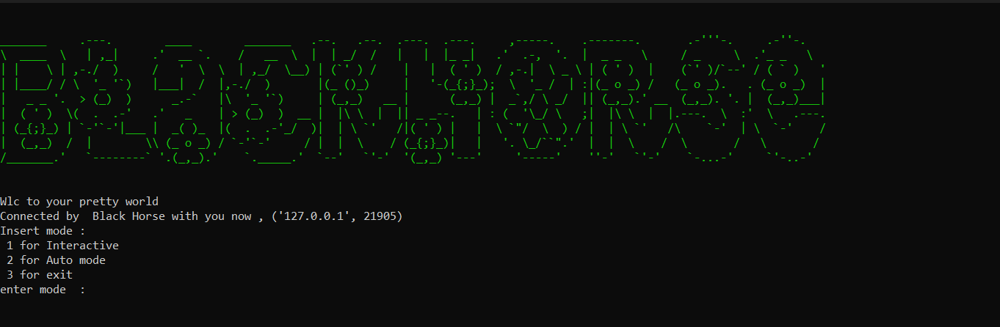
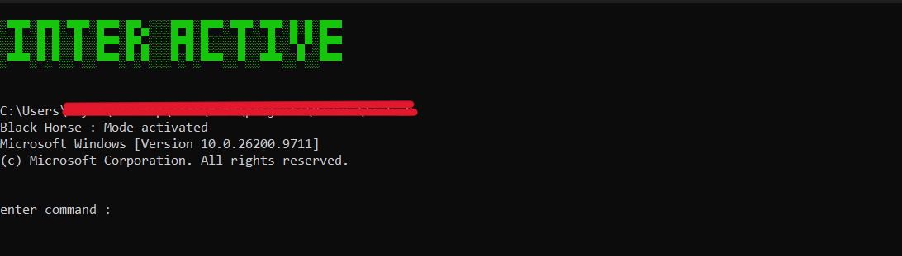
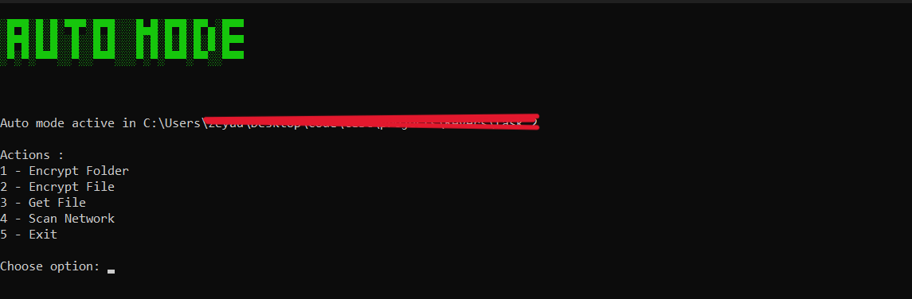
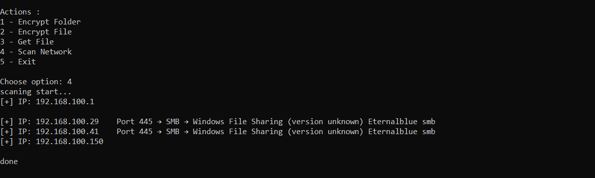

# 🐴 Black Horse — Educational C2 RAT

> **⚠️ Disclaimer:** This project is **for educational purposes only**. It was built as a university assignment for a Malware Development course. It is **not** intended for malicious use. Run it **only** in an isolated VM / lab environment. The author is **not responsible** for any misuse.

---

## 📖 Overview

**Black Horse** is a simple, modular **Command & Control (C2) Remote Access Trojan (RAT)** written in Python, built to demonstrate core malware development concepts in a controlled, academic setting.

It implements a **client–server** architecture:

- **`BlackHorse.py`** — the **Agent** (implant) that runs on the target machine.
- **`C2_BlackHorse.py`** — the **C2 Server** (operator console) that controls the agent.
- **`scanig.py`** — a helper module for **local network reconnaissance** (ping sweep + port/service detection).

The project focuses on **reliability**: every feature is hardened against connection loss, broken pipes, races, and partial failures — so it behaves predictably during live demos.

---

## 🖼️ Screenshots

### Main C2 Console


_The C2 landing screen with the ASCII banner and mode selection._

### Interactive Shell Mode


_Remote `cmd.exe` session — commands are executed on the agent and output is streamed back in real time._

### Auto Mode Menu


_Auto mode: Encrypt Folder / Encrypt File / Get File / Scan Network / Exit._

### Network Scan


_Local subnet discovery: live hosts, open ports (22/80/443/445), and basic service banners._

---

## ✨ Features

| Feature                         | Description                                                                                                                  |
| ------------------------------- | ---------------------------------------------------------------------------------------------------------------------------- |
| 🔌 **Persistent C2 channel**    | Length-safe messaging with a `__END__` delimiter and error-tolerant decoding.                                                |
| 🖥️ **Interactive Remote Shell** | Full `cmd.exe` bridge — input and output streamed over the socket.                                                           |
| 🤖 **Auto Mode**                | Menu-driven operations: folder encryption, file encryption, exfiltration, reconnaissance.                                    |
| 🔐 **File / Folder Encryption** | `cryptography.fernet` with `.dark` extension; skips already-encrypted files.                                                 |
| 📤 **File Exfiltration**        | Binary-safe transfer using `latin-1` round-trip encoding.                                                                    |
| 🌐 **Network Recon**            | Ping sweep + port scan (22, 80, 443, 445) with HTTP/SSH/SMB banner hints.                                                    |
| 🧠 **CWD Persistence**          | The agent remembers the last working directory between shell sessions.                                                       |
| 🛡️ **Robust error handling**    | Connection loss, broken pipes, dead processes, and partial failures are handled silently on the agent and visibly on the C2. |
| 🎭 **Silent exit**              | The agent terminates silently on C2 loss (no traceback, no error window).                                                    |

---

## 🏗️ Architecture

```

┌──────────────────────────┐ TCP (127.0.0.1:65449) ┌──────────────────────────┐
│ C2_BlackHorse.py │ ◄──────────────────────────────────► │ BlackHorse.py │
│ (Operator Console) │ │ (Agent / Implant) │
│ │ │ │
│ - Interactive mode │ **END**-delimited messages │ - shell() dispatcher │
│ - Auto mode │ │ - cmd_interactive() │
│ - File receiver │ │ - enc_folder/enc_file │
│ - Scan viewer │ │ - send_file() │
│ │ │ - scaning() │
└──────────────────────────┘ └──────────────────────────┘
│
▼
┌──────────────────┐
│ scanig.py │
│ (LAN recon util) │
└──────────────────┘

```

### Message Flow (example: Encrypt File)

```

C2 Agent
│── "2" ──────────────────────────────────►│
│◄───────────────────── "done file is X" ──│
│── "path/to/file" ───────────────────────►│
│◄───────────────────── "done key is K" ───│
│── "<fernet-key>" ───────────────────────►│
│◄─────────────────────── "working" ───────│
│ │ encrypt_file()
│◄────────────────────────── "done" ───────│

```

---

## 🚀 Getting Started

### Requirements

- **Python 3.8+**
- **Windows** (the agent uses `cmd.exe`; `scanig` uses `ping -n`)
- Install dependencies:

```bash
pip install cryptography
```

> `scanig.py` uses only the standard library (`socket`, `subprocess`, `concurrent.futures`).

### Run (Local Lab)

Open **two terminals**:

**Terminal 1 — start the C2:**

```bash
python C2_BlackHorse.py
```

**Terminal 2 — start the agent:**

```bash
python BlackHorse.py
```

The C2 will accept the connection and print:

```
Connected by  Black Horse with you now , ('127.0.0.1', <port>)
```

Then choose a mode:

```
Insert mode :
 1 for Interactive
 2 for Auto mode
 3 for exit
```

---

## 🧭 Usage

### 1) Interactive Mode

Select `1`. You get a full `cmd.exe` session:

- Type any Windows command (`dir`, `whoami`, `ipconfig`, …).
- Type `exit` to return to the C2 menu.
- The agent **remembers the last working directory** — the next session starts there.

### 2) Auto Mode

Select `2`. Then:

| Option | Action                                                                           |
| ------ | -------------------------------------------------------------------------------- |
| `1`    | **Encrypt Folder** — recursively encrypt all files in a folder (skips `*.dark`). |
| `2`    | **Encrypt File** — encrypt one file and rename to `*.dark`.                      |
| `3`    | **Get File** — download a file from the agent's CWD to `steal` on the C2.        |
| `4`    | **Scan Network** — ping sweep + port scan of the local /24 subnet.               |
| `5`    | **Exit** — return to the C2 main menu.                                           |

### 3) Exit

Select `3` to close the C2 cleanly.

---

## 🔐 Encryption Notes

- Uses **`cryptography.fernet`** (AES-128-CBC + HMAC-SHA256).
- The key is generated **once** at C2 startup (`Fernet.generate_key()`), and sent to the agent per operation.
- Encrypted files receive the **`.dark`** extension.
- Already-encrypted files (`*.dark`) are **skipped** to prevent double encryption and key loss.
- ⚠️ **No key recovery mechanism** is implemented — this is intentional for the academic scope. **Do not run on real data.**

---

## 🛡️ Hardening & Error Handling

This project deliberately hardens the "boring" parts that break live demos:

| Scenario                      | Agent behavior                  | C2 behavior                       |
| ----------------------------- | ------------------------------- | --------------------------------- |
| C2 closed                     | Silent exit (`os._exit`)        | —                                 |
| Agent closed                  | —                               | `[!] connection lost with agent`  |
| Broken pipe in shell          | `send("Shell closed")` + return | Printed by `recv_loop`            |
| Locked file during encryption | Skipped silently                | Operation completes with `"done"` |
| Wrong Fernet key              | Caught, `"done"` still sent     | No hang                           |
| Double encryption             | Skipped via `*.dark` check      | No data loss                      |
| Missing `scanig.py`           | `send("done")` fallback         | No hang                           |
| Race on `stdout`              | (see Known Limitations)         | —                                 |

---

## ⚠️ Known Limitations

- **Windows-only**: the interactive shell uses `cmd.exe`; `scanig` uses `ping -n`.
- **No persistence**: the agent does not survive reboot (out of scope).
- **No encryption key exchange**: the Fernet key travels in plaintext over the socket (academic simplification).
- **Race on `stdout`**: `forward_output` and `get_current_dir_cmd` both read `procc.stdout`. In practice it works, but under heavy load a `Lock + Event` would be safer.
- **`readline()` blocks on commands without newline** (e.g. `ping -t`).
- **`scanig.py`** requires the `ping` command and local network access.
- **No authentication**: anyone who reaches the C2 port can connect (bind to `127.0.0.1` only).

---

## 📁 Project Structure

```
.
├── BlackHorse.py          # Agent (implant)
├── C2_BlackHorse.py       # C2 server (operator console)
├── scanig.py              # LAN reconnaissance helper
├── README.md
```

---

## 🎓 Academic Context

This project was developed for a **Malware Development** university course. Its goals:

1. Demonstrate a **client–server C2** architecture.
2. Implement a **remote shell** via `subprocess`.
3. Implement **file encryption** (ransomware simulation) with `cryptography`.
4. Implement **file exfiltration** over a raw socket.
5. Implement **local network reconnaissance** (ping sweep + port scan).
6. Practice **defensive programming** in offensive tooling (robust error handling, silent failure, graceful degradation).

---

## 📜 License

This project is licensed under the **MIT License** with an
**Ethical Use Addendum**. See [LICENSE](LICENSE) for full terms.

**In short:** free to use for education and research — **not** for
malicious, commercial, or unauthorized use. The author assumes no
liability for misuse.
